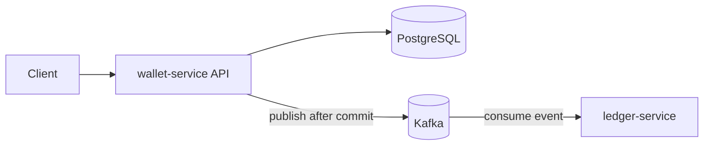

# 02 - Big Picture Map

The 5 problems are not isolated topics. They are connected backend foundations.

## How Problems Map to Real Backend Knowledge

- Race condition -> Java memory model, thread safety, lock strategy, performance under contention
- ThreadLocal leak -> request lifecycle, thread pools, security context handling
- LazyInitializationException -> transaction boundaries, ORM fetch strategy, API contracts
- Lost update -> isolation levels, locking, correctness in financial flows
- CompletableFuture starvation -> async architecture, executor design, resilience

## Big Picture Areas You Need

### 1) API Design

- resource naming and versioning
- request validation
- error contracts
- idempotency for unsafe retries

### 2) System Design

- consistency vs availability tradeoffs
- synchronous vs event-driven boundaries
- retries, backpressure, and timeout strategy

Current project flow:

### 3) Database Engineering

- schema design
- indexing strategy
- isolation levels
- read/write patterns
- lock contention analysis

### 4) Spring Internals

- transaction proxy behavior
- request filter chain
- SecurityContext lifecycle
- AOP advice and where cross-cutting logic belongs

### 5) Reliability and Operations

- logs, metrics, tracing
- incident triage
- reproducible debugging
- CI checks before merge

## Interview Follow-up Questions You Should Expect

- "How does Spring Security prevent ThreadLocal leaks?"
- "Where would you use AOP here?"
- "Which isolation level would you choose and why?"
- "How would you detect this issue in production?"
- "How would you test this under concurrent load?"

## Practical Rule

For every feature you build, answer this checklist:

1. What is the API contract?
2. What is the transaction boundary?
3. What is the database access pattern?
4. What happens under concurrency?
5. What is the fallback when dependencies are slow?
6. How will we observe and debug this in production?
